# Awesome Constraint Solving & Optimization 

  

  
  
  
  
  
  
  

  <strong>Curated directory of mathematical optimization solvers, mixed-integer linear programming (MILP), constraint programming (CP-SAT), SAT/SMT theorem provers, vehicle routing engines (VRP), and algebraic modeling languages (AML).</strong>

---

## 🧭 Navigation & Table of Contents

- [🌟 Overview & SEO Keywords](#-overview--seo-keywords)
- [📊 Sector Overview & Market Dynamics](#-sector-overview--market-dynamics)
- [💼 SaaS & Hosted Optimization Platforms](#-saas--hosted-optimization-platforms)
- [💻 Open-Source GitHub Projects](#-open-source-github-projects)
  - [🏆 High-Star Flagships & Modeling Frameworks](#-high-star-flagships--modeling-frameworks)
  - [⚡ High-Performance Solvers (MILP, LP & QP)](#-high-performance-solvers-milp-lp--qp)
  - [🚚 Logistics, Scheduling & Routing Engines (VRP)](#-logistics-scheduling--routing-engines-vrp)
  - [🔬 SAT/SMT Solvers & Discrete Constraint Engines](#-satsmt-solvers--discrete-constraint-engines)
- [🛠️ Recommended Architecture & Workflows](#️-recommended-architecture--workflows)
- [🤝 How to Contribute](#-how-to-contribute)
- [💖 Support & Sponsorship](#-support--sponsorship)
- [📈 Star History](#-star-history)
- [⚖️ Disclaimer](#️-disclaimer)

---

## 🌟 Overview & SEO Keywords

Welcome to the definitive **Awesome Constraint Solving & Mathematical Optimization** repository — tracking the state of the art in numerical solvers, combinatorial optimization, operations research (OR), prescriptive analytics, and automated decision-ops.

Whether you are modeling multi-million-variable supply-chain logistics, optimizing last-mile vehicle fleet routing (VRP), compiling constraint logic with SAT/SMT provers, or deploying real-time decision microservices on the cloud, this curated index covers enterprise commercial engines and cutting-edge open-source software libraries.

> **Target Capabilities:** `Mixed-Integer Linear Programming (MILP)` • `Constraint Programming (CP-SAT)` • `SAT / SMT Theorem Provers` • `Convex Optimization` • `Quadratic Programming (QP)` • `Nonlinear Programming (NLP)` • `Vehicle Routing Problem (VRP)` • `Workforce Scheduling & Rostering` • `Algebraic Modeling Languages (AML)` • `Decision-Ops Cloud APIs`

---

## 📊 Sector Overview & Market Dynamics

The global mathematical optimization and prescriptive analytics software market is valued at approximately **$1.85B to $2.2B** (scaling toward **$4.7B–$5.2B+** over the next decade at an estimated **11.0%–11.5% CAGR**), expanding into a broader **$10B+** footprint when factoring in integrated enterprise supply-chain planning suites, decision intelligence, and automated dispatch operations.

### Market Concentration vs. Fragmentation
* **Core Solver Engines (Concentrated / Oligopolistic):** At the fundamental numerical solver engine layer (simplex algorithms, interior-point barrier methods, branch-and-cut, and pre-solve heuristics), the industry exhibits high concentration. A handful of deeply entrenched commercial leaders (IBM CPLEX, Gurobi, FICO Xpress) alongside foundational academic/open-source solvers (HiGHS, SCIP, COIN-OR CBC, Z3) form an oligopolistic core with steep technical barriers to entry.
* **Vertical Decision-Ops & Industry Applications (Moderately Fragmented):** At the higher-level modeling, domain orchestration, and dispatch SaaS layer, the market is moderately fragmented. Domain-specialized platforms compete across dedicated verticals—ranging from vehicle fleet routing and workforce scheduling (Timefold, Nextmv) to supply-chain network design (AIMMS) and cloud-based algebraic modeling collaboration (AMPL Cloud, Analytic Solver Cloud).

---

## 💼 SaaS & Hosted Optimization Platforms

Below is a curated comparison of leading SaaS products and cloud-hosted optimization suites, ordered by **Company Scale (Estimated Revenue / Market Valuation) in descending order**.

| Platform | Core Capabilities & Description | Starting Pricing (Specific Tier) | Free Tier / Free Trial Limits | Company Scale (Est. Revenue / Valuation) |
| :--- | :--- | :--- | :--- | :--- |
| **[IBM ILOG CPLEX Optimization Studio](https://www.ibm.com/products/ilog-cplex-optimization-studio)** | Enterprise-grade mathematical optimization studio combining industrial simplex/barrier LP/MILP solvers with Constraint Programming (`CP Optimizer`) and OPL modeling. | **$320.00/month** for Developer Subscription (monthly self-serve recurring developer license) | **Free forever Community Edition** restricted to models with a maximum of **1,000 variables and 1,000 constraints** (no commercial production usage) | ~$190B Market Cap / ~$62B Annual Revenue (IBM Enterprise) |
| **[FICO Xpress Optimization](https://www.fico.com/en/products/fico-xpress-optimization)** | High-performance commercial mathematical solver and cloud decision-modeling platform supporting linear, mixed-integer, nonlinear (SLP), and constraint programming. | **$400.00/month** (entry commercial solver license via AMPL integration / cloud channel) | **Free forever Community License** capped at **5,000 combined rows + columns** for LP/MIP, **200 rows/columns** for NLP, and **50 variables/constraints** for Kalis CP | ~$16.5B Market Cap / ~$2.53B Annual Revenue |
| **[Gurobi Optimizer & Instant Cloud](https://www.gurobi.com)** | Industry-leading commercial mathematical optimization solver for LP, MILP, QP, MIQP, and MINLP featuring distributed cloud compute managers and automatic algorithm tuning. | **$10,000.00/year** (commercial baseline starting tier for entry single-user commercial license / cloud pool baseline) | **30-day free commercial evaluation trial** with **unconstrained model size limits** (academic licenses are free forever with no limits) | ~$1.5B+ Valuation / ~$75M–$100M ARR (Private Equity backed by TSCP) |
| **[AIMMS Cloud Platform](https://www.aimms.com)** | Prescriptive analytics and supply-chain optimization SaaS enabling operations research teams to build and deploy interactive web applications over complex models. | **$2,500.00/month** ($30,000.00/year entry commercial deployment package for PRO / Essential tier) | **Free forever Community Edition** for personal modeling and prototyping, limited exclusively to open-source solvers (**CBC, IPOPT, AOA**) | ~$30M–$40M ARR / ~$150M–$200M Valuation |
| **[Frontline Systems (Analytic Solver Cloud)](https://www.solver.com)** | Cloud and Excel-integrated mathematical optimization, Monte Carlo simulation, and stochastic programming platform for business analytics and operations research. | **$250.00/month** ($3,000.00/year billed annually for *Analytic Solver Optimization* commercial tier) | **15-day free trial** with full solver features; small-to-medium models return full solutions, while **large-scale models omit full solution results** | ~$15M–$25M ARR / Bootstrapped Enterprise |
| **[AMPL Cloud & Model Collaboratory](https://ampl.com)** | Cloud-hosted algebraic modeling environment and multi-solver execution platform connecting mathematical notation seamlessly to open-source and commercial engines. | **$400.00/month** (commercial solver integration tier billed annually) | **Free forever Community Edition** with **unlimited variables and constraints** exclusively when executing open-source solvers (HiGHS, CBC, SCIP, IPOPT) | ~$10M–$20M ARR / Private Independent |
| **[Timefold Cloud](https://timefold.ai)** | AI-driven operational planning and scheduling optimization SaaS platform (evolved from OptaPlanner) specialized in vehicle routing, shift rostering, and maintenance. | **$1,500.00/month** (entry *Spark* managed cloud API tier for single-tenant API workloads) | **14-day free trial** on Timefold Platform (`app.timefold.ai`) for pre-built routing and shift-scheduling models (core engine is Apache 2.0 open source) | ~$22M Total VC Funding / ~$3.3M ARR (Fast-growing Series A) |
| **[Hexaly (formerly LocalSolver)](https://www.hexaly.com)** | Global mathematical optimization solver combining primal heuristics, local search, and constraint propagation to conquer massive combinatorial routing and scheduling. | **$800.00/month** (flat-fee annual commercial subscription tier starting at ~$9,600/year) | **30-day free commercial evaluation trial** strictly for testing and validation (free unlimited licenses available for accredited academics) | ~$5M–$10M ARR / Bootstrapped Deep-Tech |
| **[Nextmv Decision Cloud](https://www.nextmv.io)** | Decision-ops cloud infrastructure for testing, benchmarking, continuous integration, and deploying custom constraint and routing optimization models as scalable APIs. | **$20.00/month** for *Innovator* tier (supports 1 team, up to 2 users, and 10 MiB output size) | **14-day free trial** providing starter compute run-time credits and API evaluation access | Acquired by FICO (May 2026) / Previously raised $14.3M VC |
| **[NEOS Server & COIN-OR Cloud](https://neos-server.org)** | Cloud optimization service hosted by the Wisconsin Institute for Discovery providing internet-based execution access to commercial and COIN-OR mathematical solvers. | **$0.00/month** (sponsored public research cloud service supported by academic and federal grants) | **Free forever public tier** subject to fair-use job queue limits, single-job CPU time limits, and non-confidential public benchmark logging | Non-profit Academic & Research Service ($0 Commercial Revenue) |

---

## 💻 Open-Source GitHub Projects

All open-source repositories below are verified active projects, sorted in **descending order by GitHub Stars Count**. Each entry features an official social star badge directly linking to that repository's stargazers page.

### 🏆 High-Star Flagships & Modeling Frameworks

1. **[bherbruck/solvecraft](https://github.com/bherbruck/solvecraft)**   
   Modern open-source constraint solving and combinatorial optimization toolkit engineered to streamline problem formulation, solver execution, and interactive graph exploration.

2. **[google/or-tools](https://github.com/google/or-tools)**   
   Google's premier open-source suite for combinatorial optimization. Features the industry-standard `CP-SAT` constraint programming solver, vehicle routing (`VRP`), network flow algorithms, and linear solver wrappers (C++, Python, Java, C#).

3. **[cvxpy/cvxpy](https://github.com/cvxpy/cvxpy)**   
   Python-embedded domain-specific language for disciplined convex optimization. Transforms high-level mathematical formulas automatically into standard conic forms for quadratic and semidefinite solvers.

4. **[Pyomo/pyomo](https://github.com/Pyomo/pyomo)**   
   Comprehensive Python-based algebraic modeling language (AML) developed by Sandia National Laboratories for formulating, analyzing, and solving LP, MILP, MINLP, and stochastic optimization models.

5. **[coin-or/pulp](https://github.com/coin-or/pulp)**   
   Clean, easy-to-use Python linear programming modeler that generates MPS or LP files and seamlessly calls HiGHS, CBC, GLPK, Gurobi, and CPLEX.

6. **[jump-dev/JuMP.jl](https://github.com/jump-dev/JuMP.jl)**   
   High-performance modeling language for mathematical optimization embedded in Julia. Achieves near-C speed during model formulation with native interfaces to 50+ linear, conic, and nonlinear solvers.

7. **[casadi/casadi](https://github.com/casadi/casadi)**   
   Open-source tool for algorithmic differentiation and numerical optimization suited for optimal control, nonlinear programming, and dynamic system parameter estimation.

---

### ⚡ High-Performance Solvers (MILP, LP & QP)

8. **[ERGO-Code/HiGHS](https://github.com/ERGO-Code/HiGHS)**   
   World-leading open-source C++ optimization solver for large-scale Linear Programming (LP), Mixed-Integer Programming (MIP), and Quadratic Programming (QP). Adopted as default solver in SciPy and Julia.

9. **[coin-or/Ipopt](https://github.com/coin-or/Ipopt)**   
   Interior Point Optimizer for large-scale continuous nonlinear programming (NLP) problems under the COIN-OR initiative.

10. **[coin-or/Cbc](https://github.com/coin-or/Cbc)**   
    Coin-or branch and cut (CBC) is a mature, production-proven open-source Mixed-Integer Linear Programming (MILP) solver written in C++.

11. **[scipopt/scip](https://github.com/scipopt/scip)**   
    The SCIP Optimization Suite is one of the fastest non-commercial solvers for Mixed-Integer Programming (MIP) and Mixed-Integer Nonlinear Programming (MINLP), integrating constraint integer programming and branch-cut-and-price.

12. **[oxfordcontrol/Clarabel.rs](https://github.com/oxfordcontrol/Clarabel.rs)**   
    Blazing-fast interior-point numerical solver written in Rust for convex optimization problems involving linear, quadratic, second-order cone, and semidefinite constraints.

13. **[coin-or/Clp](https://github.com/coin-or/Clp)**   
    COIN-OR Linear Programming (CLP) simplex solver designed for high-throughput continuous linear optimization.

---

### 🚚 Logistics, Scheduling & Routing Engines (VRP)

14. **[VROOM-Project/vroom](https://github.com/VROOM-Project/vroom)**   
    Ultra-fast open-source Vehicle Routing Problem (VRP) engine in C++ solving Traveling Salesman (TSP), pickup-and-delivery, and capacity time-window routing in milliseconds. Integrates with OSRM, OpenRouteService, and Valhalla.

15. **[TimefoldAI/timefold-solver](https://github.com/TimefoldAI/timefold-solver)**   
    Leading open-source AI constraint satisfaction and planning engine (Java, Python, Kotlin) utilizing metaheuristics (tabu search, simulated annealing) to solve employee shift rostering, vehicle routing, and bin packing.

---

### 🔬 SAT/SMT Solvers & Discrete Constraint Engines

16. **[Z3Prover/z3](https://github.com/Z3Prover/z3)**   
    The industry-standard Satisfiability Modulo Theories (SMT) solver from Microsoft Research. Powers automated theorem proving, hardware/software formal verification, and symbolic constraint satisfaction.

17. **[MiniZinc/libminizinc](https://github.com/MiniZinc/libminizinc)**   
    High-level, solver-independent constraint modeling language that compiles expressive discrete decision models into FlatZinc for CP-SAT, Chuffed, Gecode, and MIP solvers.

18. **[arminbiere/kissat](https://github.com/arminbiere/kissat)**   
    Multiple SAT Competition first-prize-winning bare-metal Boolean Satisfiability (SAT) solver written in pure C by Armin Biere.

19. **[arminbiere/cadical](https://github.com/arminbiere/cadical)**   
    High-performance incremental SAT solver designed with inprocessing techniques and certified UNSAT proof logging (DRAT).

20. **[Gecode/gecode](https://github.com/Gecode/gecode)**   
    Open, efficient C++ environment for developing constraint-based systems and finite domain constraint programming.

21. **[chuffed/chuffed](https://github.com/chuffed/chuffed)**   
    State-of-the-art C++ constraint satisfaction solver employing lazy clause generation (LCG) to bridge finite-domain propagation with SAT conflict clause learning.

---

## 🛠️ Recommended Architecture & Workflows

When deploying modern operations research and constraint optimization pipelines into production, consider the following architectural pairings:

- **Mathematical Programming (LP / MILP):** Combine **Pyomo** (Python) or **JuMP.jl** (Julia) with **HiGHS** or **SCIP** for an ultra-fast, permissive open-source pipeline; step up to **Gurobi** or **CPLEX** for industrial-scale billion-nonzero models.
- **Discrete Combinatorial Scheduling & Puzzles:** Pair **MiniZinc** modeling with **Google OR-Tools (`CP-SAT`)** or **Chuffed** for automated branch-and-bound constraint propagation.
- **Dynamic Fleet Dispatch & Vehicle Routing:** Integrate **VROOM** or **Google OR-Tools VRP** alongside **OSRM** for real-time turn-by-turn routing, or **Timefold Solver** for complex driver break rules and capacity constraints.
- **Formal Verification & Theorem Proving:** Utilize **Z3** or **CaDiCaL** with SMT-LIB2 formulations for bounded model checking and symbolic program analysis.

---

## 🤝 How to Contribute

We welcome additions, updates, and benchmark contributions from the community!

1. 🍴 **Fork the repository** on GitHub.
2. 🌿 **Create a feature branch** (`git checkout -b feature/add-solver-name`).
3. 📝 **Add your solver or platform** to the appropriate section following the established format:
   - For SaaS: include name, description, specific starting price, free tier limit, and company scale.
   - For Open-Source: include repo link, social star badge linking to stargazers, and concise summary.
4. 🧪 **Verify table alignment & Markdown syntax**.
5. 🚀 **Submit a Pull Request** with a brief summary of the project.

---

## 💖 Support & Sponsorship

If this curated repository saved you hours of solver benchmarking or helped your team architect an optimization pipeline, please consider supporting the project:

- ⭐ **Star this repository** to improve discoverability across GitHub.
- 📢 **Share with your colleagues** on LinkedIn, X/Twitter, and OR forums.
- ☕ **Sponsor on GitHub Sponsors**: Back continuous maintenance and updates via [GitHub Sponsors](https://github.com/sponsors/ishandutta2007).

  

---

## 📈 Star History

---

## ⚖️ Disclaimer

- This curated list is maintained for informational and educational purposes only. Product names, logos, and brands are property of their respective owners.
- Commercial solvers (Gurobi, IBM CPLEX, FICO Xpress) require appropriate enterprise licenses for production deployments; verify community edition constraint caps before building commercial applications.
- Mathematical optimization problems classified as NP-hard (such as large-scale TSP or mixed-integer non-convex programs) can experience exponential compute times; always benchmark solver heuristics, set MIP optimality gaps, and enforce memory/time bounds in production microservices.
